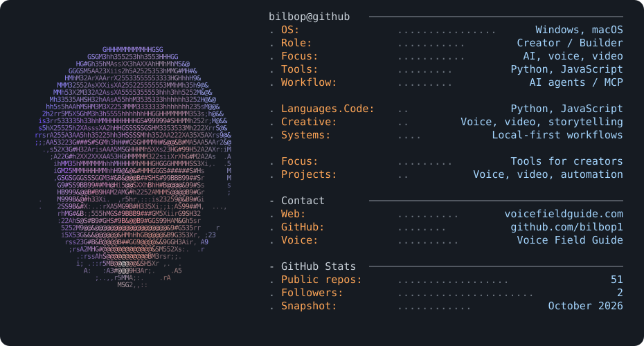

## About

I’m Bilbop. I make videos, work with voices, and build tools that help creators turn ideas into things people can actually use. I like experimenting with AI agents, automation, and the messy work of making a creative workflow more useful.

## Tech Stack

    

## Featured Projects

| Project | Description | Stars |
| --- | --- | --- |
| [Voice Field Guide](https://voicefieldguide.com/) | Voice demos, casting guidance, and practical resources. | — |
| [Prestige Voices](https://github.com/bilbop1/prestige-voices) | Explore and audition voices for a project. | 1 |
| [moneyprinter-md](https://github.com/bilbop1/moneyprinter-md) | Turn AI work into a focused action plan. | 2 |

[Explore my repositories](https://github.com/bilbop1?tab=repositories)
